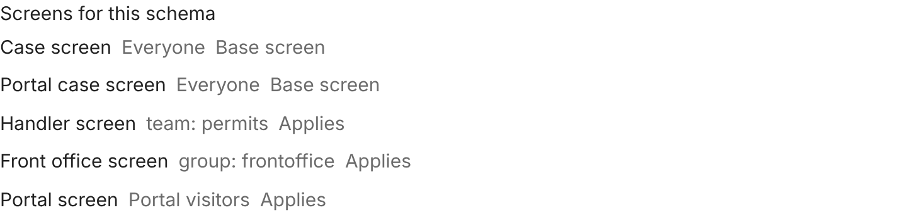
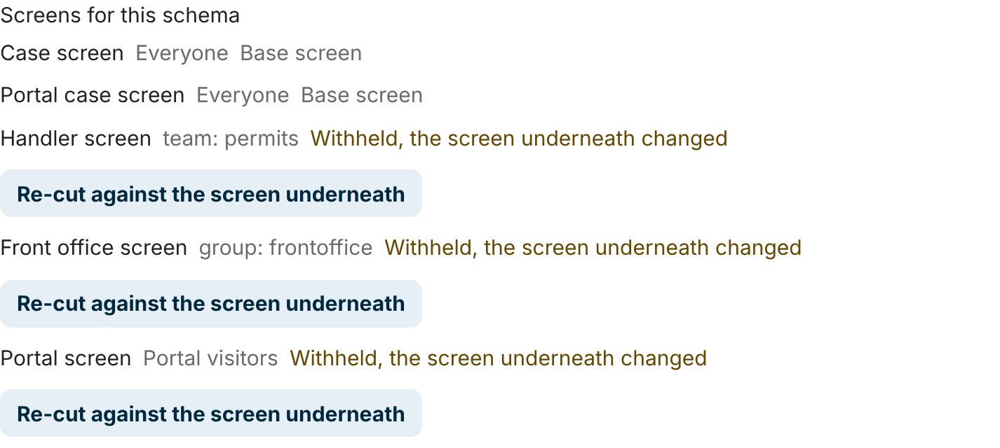
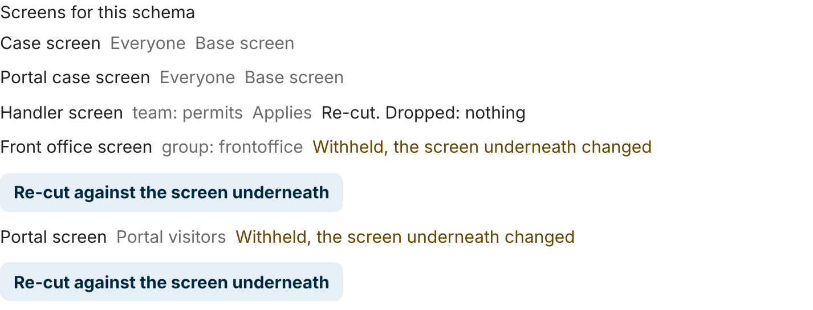

# Screen overrides

A [layout per case type](./case-type-layouts.md) gives every case of one type the
same screen. A screen override changes that screen for one audience only: the
permits team sees "Handling and decision", the front office does not see the
history tab, and a resident on the portal sees "Your application" and nothing
about the handling.

An override is not a copy of the screen. It stores only what it changes, and
it is applied on top of the screen underneath it every time the page opens. A
tab added to the case type's screen later shows up in every override too.

## Who an override is for

Open the detail page in the page designer and go to "Applies to". Give the
screen a name, fill in the type property and value of the case type, and pick
the audience:

- **Everyone**: the screen of the case type itself.
- **Organisation**: members of one organisation.
- **Group** or **Team**: members of one Nextcloud group or team.
- **Portal visitors**: residents and companies on the portal. A caller without an
  account never gets an internal screen.
- **User**: one person.

Screens stack in that order. Each one patches the one below it, and the most
specific screen that applies to the caller wins.

## The screens of a schema

Under "Screens for this schema" the designer lists every screen of the detail
page's schema: who each one is for and whether it applies.

## When the screen underneath changes

An override remembers the screen it was cut against. When that screen changes,
for example a tab is removed, the override is **withheld**: the page opens on
the screen underneath, unchanged, and the override is kept exactly as it was.
It never breaks the page.

The first time a withheld override is resolved for a case, it moves to the
state **Needs review**, and its maintainer is told that "A screen override needs
reviewing".

**Re-cut against the screen underneath** pins the override to the screen as it
is now. Whatever the override changed that no longer exists is dropped, and the
list says what was dropped; "nothing" means the whole override still applies.

